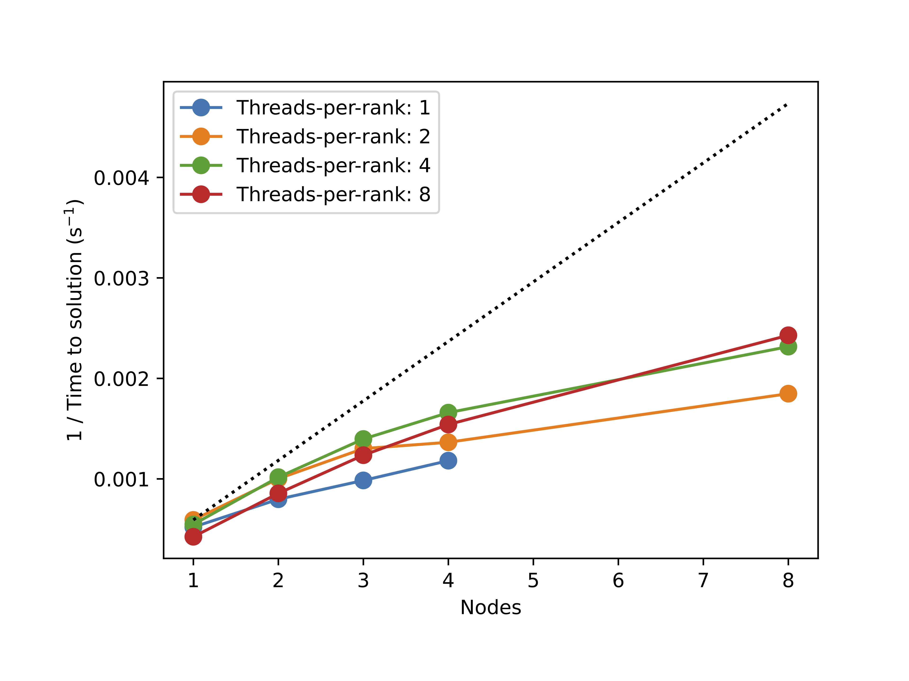
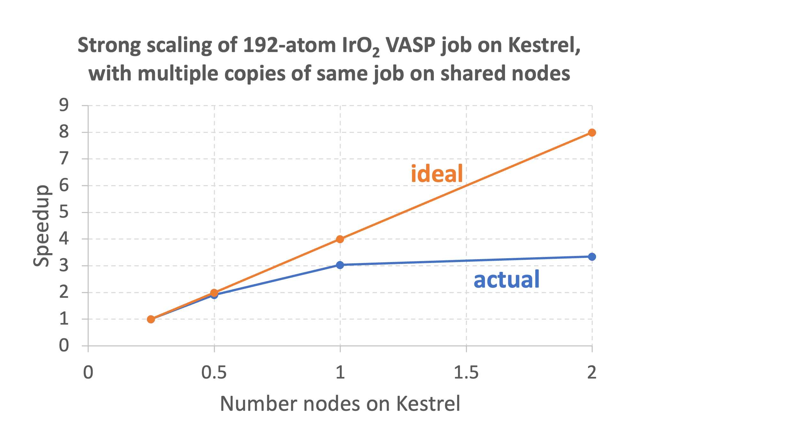

The Vienna Ab initio Simulation Package (VASP) is an application for atomic scale materials modelling from first principles. VASP computes an approximate solution to the many-body Schrödinger equation, either within density functional theory or within the Hartree-Fock approximation using pseudopotentials and plane wave basis sets. VASP can carry out a range of electronic structure and quantum-mechanical molecular dynamics calculations and has many features including hybrid functionals, Green's functions methods (GW quasiparticles, and ACFDT-RPA) and many-body perturbation theory (2nd-order Møller-Plesset). For a full list of capabilities, please see the [About VASP](https://www.vasp.at/info/about/) page and for further details, documentation, forums, and FAQs, visit the [VASP website](https://www.vasp.at/).

## Accessing VASP on NLR's HPC Clusters
!!! tip "Important"
	The VASP license requires users to be a member of a "workgroup" defined by the University of Vienna or Materials Design. If you are receiving "Permission denied" errors when trying to use VASP, you must be made part of the "vasp" Linux group first. To join, please contact [HPC Help](mailto:hpc-help@nlr.gov) with the following information:

	```
	- Your name
    - The workgroup PI
    - Whether you are licensed through Vienna (academic) or Materials Design, Inc. (commercial)
    - If licensed through Vienna:
        - The e-mail address under which you are registered with Vienna as a workgroup member (this may not be the e-mail address you used to get an HPC account)
        - Your VASP license ID
    - If licensed through Materials Design:
        - Proof of current licensed status

	```
    Once status can be confirmed, we can provide access to our VASP builds. 

## Getting Started
VASP is available through modules on all HPC systems. To view the available versions of VASP modules on each cluster, use the command `module avail vasp`. To see details for a specific version, use `module show vasp/<version>`. To load a specific version, use `module load vasp/<version>`. If no version is specified, the default module (marked with "(D)") will be loaded.  In the following sections, we will give sample submission scripts and performance recommendations. To run VASP, the following 4 input files are needed: POSCAR, POTCAR, INCAR, KPOINTS. For more information about VASP input files, see the [VASP wiki](https://www.vasp.at/wiki/index.php/Input).

Each VASP module provides three executables where the correct one should be chosen for the type of job:

1. `vasp_std` is for general k-point meshes with collinear spins

2. `vasp_ncl` is for general k-point meshes with non-collinear spins

3. `vasp_gam` is for Gamma-point-only calculations

NLR also offers build and module support for additional functionalities such as [transition state theory tools from University of Texas-Austin](http://theory.cm.utexas.edu/vtsttools/), [implicit solvation models from the University of Florida](http://vaspsol.mse.ufl.edu/), and [BEEF-vdw functionals](https://github.com/vossjo/libbeef). Please contact [HPC-Help](mailto:hpc-help@nlr.gov) if a functionality you need is not present in one of our builds.

!!! warning "Attention"
	If you would like to build your own VASP on Kestrel, please read our section [Building VASP on Kestrel](vasp.md#building-vasp-on-kestrel) carefully before compiling on Kestrel's cray architecture. 

## Supported Versions
NLR offers modules for VASP 5 and VASP 6 on CPUs as well as GPUs on certain systems. See table below for current availability, as well as system specific documentation for more details on running different builds.

|             |    Kestrel    |     Swift     |   Vermilion   |
| ----------- | ------------- | ------------- | ------------- |
| VASP 5      |       X       |               |       X       |
| VASP 6      |       X       |       X       |       X       |
| VASP 6 GPU  |       X       |       X       |       X       |


## VASP on Kestrel

??? note "Performance Note" 
    As part of the Computational Sciences Tutorial Series, NLR's Computational Sciences Center hosted "Fast and Efficient VASP: Accelerating and Optimizing    Workflows on CPUs and GPUs." The tutorial provides performance recommendations for Kestrel, including guidance on when it is more efficient to run calculations on GPUs (for example, hybrid calculations or larger GGA calculations with more than ~200 atoms). Please see this link to access [a copy of our presentation](https://nrel.sharepoint.com/:b:/r/sites/ComputationalSciencesTutorials/Shared%20Documents/HPC%20User%20Community/Slides/6%20-%20Applications%20of%20HPC/Fast,%20Efficient%20VASP%20-%20Accelerating%20and%20Optimizing%20Workflows%20on%20GPUs%20and%20CPUs.pdf?csf=1&web=1&e=69hKjB).

### Running Using Modules

#### CPU

There are several modules for CPU builds of VASP 5 and VASP 6.

```
CPU $ module avail vasp
---------------- /nopt/nrel/apps/cpu_stack/modules/default/application -----------------
   vasp/5.4.4+tpc           vasp/6.3.2_openMP        vasp/6.5.1_openMP+tpc
   vasp/5.4.4               vasp/6.4.2_openMP+tpc    vasp/6.5.1_openMP     (D)
   vasp/6.3.2_openMP+tpc    vasp/6.4.2_openMP
```

 Notes:
 
 * These modules have been built with the latest Cray Programming Environment (cpe23), updated compilers, and math libraries.
 * OpenMP capability has been added to VASP 6 builds.
 * Modules that include third-party codes (e.g., libXC, libBEEF, VTST tools, and VASPsol) are now denoted with +tpc. Use `module show vasp/<version>` to see details of a specific version.

**We encourage users to switch to the new builds and strongly recommend using OpenMP parallelism.**

!!! tip "Important: Conserving your AUs on Kestrel"
	Kestrel nodes have nearly 3x as many cores as Eagle's did. Our testing has indicated VASP DFT jobs up to 200 atoms run more efficiently on a fraction of a node (see performance notes below). We therefore highly recommend that VASP DFT users check the efficiency of their calculations and consider using the shared partition to get the most out of their allocations. Please see the sample shared job script provided below and the [Shared partition documentation](../Systems/Kestrel/Running/index.md#shared-node-partition).

??? example "Sample job script: Kestrel - Full node w/ OpenMP"

    Note: (--ntasks-per-node) x (--cpus-per-task) = total number of physical cores you want to use per node. Here 4x26=104, all cores/node.

    ```
    #!/bin/bash
    #SBATCH --nodes=2
    #SBATCH --tasks-per-node=26 # set number of MPI ranks per node
    #SBATCH --cpus-per-task=4 # set number of OpenMP threads per MPI rank
    #SBATCH --time=2:00:00
    #SBATCH --account=<your-account-name>
    #SBATCH --job-name=<your-job-name>

    module load vasp/<version with openMP>

    # Recommended settings to improve stability of OpenMP runs
    export OMP_NUM_THREADS=8    # Match this to the number of OpenMP threads (cpus-per-task above)
    export OMP_PROC_BIND=spread
    export OMP_PLACES=cores
    export OMP_STACKSIZE=1G
    ulimit -s unlimited

    srun vasp_std &> out
    ```

??? note "Performance Note"

    The use of OpenMP threads is highly recommended on a system with as many cores per node as Kestrel. Testing of benchmark 2 has shown that OpenMP threads can both increase performance (faster time to solution) as well as scaling:

    

??? example "Sample job script: Kestrel - Full node"

    ```
    #!/bin/bash
    #SBATCH --nodes=2
    #SBATCH --tasks-per-node=104
    #SBATCH --cpus-per-task=1
    #SBATCH --time=2:00:00
    #SBATCH --account=<your-account-name>
    #SBATCH --job-name=<your-job-name>

    module load vasp/<version>

    srun vasp_std &> out
    ```

??? example "Sample job script: Kestrel - Shared (partial) node"

    As described in detail in the [Shared partition documentation](../Systems/Kestrel/Running/index.md#shared-node-partition), when you run on part of a node, you will be charged for the greater of either the fraction of cores (104 total) or of memory (about 240G total or 2.3G/core) requested. The script below shows how to request 1/4 of a node, but you can freely set `--tasks` and `--mem-per-cpu` as you see fit.

    ```
    #!/bin/bash
    #SBATCH --nodes=1
    #SBATCH --partition=shared
    #SBATCH --tasks=26 #How many cpus you want
    #SBATCH --mem-per-cpu=2G #Default is 1 GB/core but this is likely too little for electronic structure calculations
    #SBATCH --time=2:00:00
    #SBATCH --account=<your-account-name>
    #SBATCH --job-name=<your-job-name>

    module load vasp/<version>

    srun vasp_std &> out
    ```

??? note "Performance Note"

    Internal testing at NLR has indicated that standard VASP DFT calculations from sizes 50-200 atoms run most efficiently on a quarter to a half node. The graph below shows the performance of a 192-atom VASP DFT job using partial nodes on the shared partition. Up to 1/2 a node, near perfect scaling is observed, but using the full node gives a speedup of only 1.5 relative to using 1/2 a node. So, the calculation will cost 50% more AUs if run on a single node compared to a half node. For a 48-atom surface Pt calculation, using the full node gives no speedup relative to using 1/2 a node, so the calculation will cost 100% more AUs if run on a single node compared to half a node. 

    

#### GPU 

!!! tip "Important"
	Submit GPU jobs from a [GPU login node](../Systems/Kestrel/index.md).
    `$ ssh <username>@kestrel-gpu.hpc.nlr.gov`

There are several modules for GPU builds of VASP 5 and VASP 6: 

```
GPU $ module avail vasp

---------------- /nopt/nrel/apps/gpu_stack/modules/default/application -----------------
   vasp/6.3.2_openMP    vasp/6.4.2_openMP    vasp/6.5.1_openMP+tpc
   vasp/6.3.2           vasp/6.4.2           vasp/6.5.1_openMP     (D)

```

??? example "Sample job script: Kestrel - Full GPU node"

    ```
    #!/bin/bash
    #SBATCH --account=<your-account-name> 
    #SBATCH --nodes=1
    #SBATCH --gpus=4 
    #SBATCH --ntasks-per-node=4
    #SBATCH --cpus-per-task=1 #The GPU partition is shared: You must specify CPUs needed even when requesting all the GPU resources
    #SBATCH --time=02:00:00
    #SBATCH --job-name=<your-job-name>
    #SBATCH --mem=350G # The GPU partition is shared: you must specify memory needed even when requesting all the GPU resources

    #NOTE: THIS MUST BE SUBMITTED FROM A GPU LOGIN NODE

    export MPICH_GPU_SUPPORT_ENABLED=1
    module load vasp/<version>

    srun vasp_std &> out

    ```

GPU nodes can be shared so you may request fewer than all 4 GPUs on a node. When doing so, you must also request appropriate CPU cores and memory. To run VASP on N GPUs, we recommend requesting `--gpus=N`, `--ntasks-per-node=N`, and `--mem=N*85G`. See the below sample script for running on 2 GPUs. 

??? example "Sample job script: Kestrel - Partial GPU node"

    ```
    #!/bin/bash
    #SBATCH --account=<your-account-name> 
    #SBATCH --nodes=1
    #SBATCH --gpus=2 
    #SBATCH --ntasks-per-node=2
    #SBATCH --mem=170G # request cpu memory 
    #SBATCH --cpus-per-task=1
    #SBATCH --time=02:00:00
    #SBATCH --job-name=<your-job-name>

    #NOTE: THIS MUST BE SUBMITTED FROM A GPU LOGIN NODE

    export MPICH_GPU_SUPPORT_ENABLED=1
    module load vasp/<version>

    srun vasp_std &> out
    ```
    
### Building VASP on Kestrel

Sample Makefiles for VASP can be found on Kestrel at `/nopt/nlr/apps/kestrel-cpu/software/vasp/binaries` (CPU versions) and `/nopt/nlr/apps/kestrel-gpu/software/vasp/binaries` (GPU versions).

!!! tip "Important"
    On Kestrel, any modules you have loaded on the login node will be copied to a compute node, and there are many loaded by default for the cray programming environment. Make sure you are using what you intend to. Please see the [Kestrel Environments](../Systems/Kestrel/Environments/index.md) page for more details on programming environments.

#### CPU
 
##### Compiling your build

??? example "Build recommendations for VASP - CPU "

    We recommend building vasp with a full Intel toolchain. Additionally, you should build on a compute node so that you have the same architecture as at runtime:

    ```
    salloc -N 1 -t <time> -A <account>
    ```
    Then, load appropriate modules for your mpi, compilers, and math packages:
    ```
    ml restore
    ml cpe-stack/25.03
    ml craype-x86-spr
    ml oneapi
    ml intel-oneapi-mpi/2021.17.2
    ml intel-oneapi-mkl/2025.3.1
    ml intel-oneapi-tbb/2021.10.0

    make DEPS=1 -j32 all
    ```

    Sample makefiles for vasp5 and vasp6 on Kestrel can be found in our [Kestrel Repo](https://github.com/NatLabRockies/HPC/tree/master/kestrel) under the vasp folder.

##### Running your build

??? example "Sample job script: How to run your own build - CPU "

    ```
    #!/bin/bash
    #SBATCH --nodes=2
    #SBATCH --tasks-per-node=104
    #SBATCH --time=2:00:00
    #SBATCH --account=<your-account-name>
    #SBATCH --job-name=<your-job-name>

    ml restore
    ml cpe-stack/25.03
    ml craype-x86-spr
    ml oneapi
    ml intel-oneapi-mpi/2021.17.2
    ml intel-oneapi-mkl/2025.3.1
    ml intel-oneapi-tbb/2021.10.0

    export VASP_PATH=/PATH/TO/YOUR/vasp_exe

    srun ${VASP_PATH}/vasp_std &> out

    ```

#### GPU

!!! tip "Important"
	Make sure to build GPU software on a [GPU login node](../Systems/Kestrel/index.md) or GPU compute node.

##### Compiling your build

??? example "Build recommendations for VASP - GPU"

    ```
    # Load appropriate modules for your build. For our example these are:
    ml restore
    ml cpe-stack/25.03
    ml craype-x86-genoa
    ml PrgEnv-nvidia
    ml cray-libsci
    ml cudatoolkit/12.9
    ml craype-accel-nvidia90

    make DEPS=1 -j32 all
    ```

##### Running your build

??? example "Sample job script: How to run your own build - GPU"

    See sample jobs scripts above for SBATCH and export directives to request full or shared gpu nodes.

    ```
    # Load modules appropriate for your build. For ours these are:
    ml restore
    ml cpe-stack/25.03
    ml craype-x86-genoa
    ml PrgEnv-nvidia
    ml cray-libsci
    ml cudatoolkit/12.9
    ml craype-accel-nvidia90

    # Export path to your buid
    export VASP_PATH=/PATH/TO/YOUR/BUILD/bin

    srun ${VASP_PATH}/vasp_std &> out
    ```

## VASP on Swift

#### CPU
??? example "Sample job script: Swift - VASP 6 CPU (Intel MPI)"
    
    ```
    #!/bin/bash
    #SBATCH --job-name="benchmark"
    #SBATCH --account=myaccount
    #SBATCH --time=4:00:00
    #SBATCH --ntasks-per-node=64
    #SBATCH --nodes=1

    #Set --exclusive if you would like to prevent any other jobs from running on the same nodes (including your own)
    #You will be charged for the full node regardless of the fraction of CPUs/node used
    #SBATCH --exclusive

    module purge

    #Load Intel MPI VASP build and necessary modules
    ml vaspintel 
    ml slurm/21-08-1-1-o2xw5ti 
    ml gcc/9.4.0-v7mri5d 
    ml intel-oneapi-compilers/2021.3.0-piz2usr 
    ml intel-oneapi-mpi/2021.3.0-hcp2lkf 
    ml intel-oneapi-mkl/2021.3.0-giz47h4

    srun -n 64 vasp_std &> out
    ```

??? example "Sample job script: Swift - VASP 6 CPU (Open MPI)"
  
    ```
    #!/bin/bash
    #SBATCH --job-name="benchmark"
    #SBATCH --account=myaccount
    #SBATCH --time=4:00:00
    #SBATCH --ntasks-per-node=64
    #SBATCH --nodes=1

    #Set --exclusive if you would like to prevent any other jobs from running on the same nodes (including your own)
    #You will be charged for the full node regardless of the fraction of CPUs/node used
    #SBATCH --exclusive

    module purge

    #Load OpenMPI VASP build and necessary modules
    ml vasp 
    ml slurm/21-08-1-1-o2xw5ti 
    ml openmpi/4.1.1-6vr2flz

    srun -n 64 vasp_std &> out
    ```

??? example "Sample job script: Swift - run multiple jobs on the same node(s)"
  
    The following script launches two instances of ```srun vasp_std``` on the same node using an array job. Each job will be constricted to 32 cores on the node. 
    ```
    #!/bin/bash
    #SBATCH --job-name="benchmark"
    #SBATCH --account=myaccount
    #SBATCH --time=4:00:00
    #SBATCH --ntasks-per-node=32
    #SBATCH --nodes=1

    #Set --exclusive=user if you would like to prevent anyone else from running on the same nodes as you
    #You will be charged for the full node regardless of the fraction of CPUs/node used
    #SBATCH --exclusive=user

    #Set how many jobs you would like to run at the same time as an array job
    #In this example, an array of 2 jobs will be run at the same time. This script will be run once for each job.
    #SBATCH --array=1-2

    #The SLURM_ARRAY_TASK_ID variable can be used to modify the parameters of the distinct jobs in the array.
    #In the case of array=1-2, the first job will have SLURM_ARRAY_TASK_ID=1, and the second will have SLURM_ARRAY_TASK_ID=2.
    #For example, you could assign different input files to runs 1 and 2 by storing them in directories input_1 and input_2 and using the following code:

    mkdir run_${SLURM_ARRAY_TASK_ID}
    cd run_${SLURM_ARRAY_TASK_ID}
    cp ../input_${SLURM_ARRAY_TASK_ID}/POSCAR .
    cp ../input_${SLURM_ARRAY_TASK_ID}/POTCAR .
    cp ../input_${SLURM_ARRAY_TASK_ID}/INCAR .
    cp ../input_${SLURM_ARRAY_TASK_ID}/KPOINTS .

    #Now load vasp and run the job...

    module purge

    #Load Intel MPI VASP build and necessary modules
    ml vaspintel 
    ml slurm/21-08-1-1-o2xw5ti 
    ml gcc/9.4.0-v7mri5d 
    ml intel-oneapi-compilers/2021.3.0-piz2usr 
    ml intel-oneapi-mpi/2021.3.0-hcp2lkf 
    ml intel-oneapi-mkl/2021.3.0-giz47h4

    srun -n 32 vasp_std &> out
    ```
??? example "Sample job script: Swift - run a single job on a node shared with other users"

    The following script launches ```srun vasp_std``` on only 32 cores on a single node. The other 32 cores remain open for other users to use. You will only be charged for half of the node hours. 

    ```
    #!/bin/bash
    #SBATCH --job-name="benchmark"
    #SBATCH --account=myaccount
    #SBATCH --time=4:00:00
    #SBATCH --ntasks-per-node=32
    #SBATCH --nodes=1

    #To make sure that you are only being charged for the CPUs your job is using, set mem=2GB*CPUs/node
    #--mem sets the memory used per node
    #SBATCH --mem=64G

    module purge

    #Load Intel MPI VASP build and necessary modules
    ml vaspintel 
    ml slurm/21-08-1-1-o2xw5ti 
    ml gcc/9.4.0-v7mri5d 
    ml intel-oneapi-compilers/2021.3.0-piz2usr 
    ml intel-oneapi-mpi/2021.3.0-hcp2lkf 
    ml intel-oneapi-mkl/2021.3.0-giz47h4

    srun -n 32 vasp_std &> out
    ```

??? note "Performance Notes"
    The Intel MPI builds are recommended over the Open MPI builds as they exhibit fastest performance.

    Use at most 64 cores/node. On Swift, each node has 64 physical cores, and each core is subdivided into two virtual cores in a process that is identical to hyperthreading. Because of this, up to 128 cores can be requested from a single Swift node, but each core will only represent half of a physical core. 

    On Swift, VASP is most efficiently run on partially full nodes. 

    Multiple jobs can run on the same nodes on Swift. If you are only using a fraction of a node, other users' jobs could be assigned to the rest of the node, which might deteriorate the performance. Setting "#SBATCH --exclusive" in your run script prevents other users from using the same node as you, but you will be charged the full 5AUs/node, regardless of the number of CPUs/node you are using. 

#### GPU

??? example "Sample job script: Swift - VASP 6 GPU (OpenACC)"
    ```
    #!/bin/bash
    #SBATCH --nodes=1
    #SBATCH --partition=gpu
    #SBATCH --gres=gpu:4
    #SBATCH --gpu-bind=map_gpu:0,1,2,3
    #SBATCH --exclusive
    #SBATCH --time=1:00:00
    #SBATCH --account=<your-account-name>
    #SBATCH --job-name=<your-job-name>

    #Load environment and openACC VASP module:
    module purge
    . /nopt/nrel/apps/env.sh
    module use /nopt/nrel/apps/modules
    module load vasp/openacc

    # Note: environment will soon become default and the module will be able to be loaded with
    # module purge
    # module load vasp/openacc

    #Launch vasp using mpirun
    mpirun -npernode 4 vasp_std &> out
    ```

## VASP on Gila

#### CPU
??? example "Sample job script: Gila - VASP 6.4.1 CPU (Intel - Intel MPI)"
  
    ```
    #!/bin/bash
    #SBATCH --job-name=vasp
    #SBATCH --nodes=1
    #SBATCH --ntasks=60
    #SBATCH --mem=60G
    #SBATCH --time=8:00:00
    #SBATCH --error=std.err
    #SBATCH --output=std.out
    #SBATCH --partition=amd
    #SBATCH --account=<allocation handle>

    ml application
    ml vasp-intel/6.4.1

    # some extra lines that have been shown to improve VASP performance on Gila when compiled against an Intel toolchain
    ulimit -s unlimited
    export I_MPI_ADJUST_REDUCE=3

    srun -n 60 vasp_std
    
    ```
??? example "Sample job script: Gila - VASP 6.4.1 CPU (GCC - OpenMPI)"
  
    ```
    #!/bin/bash
    #SBATCH --job-name=vasp
    #SBATCH --nodes=1
    #SBATCH --ntasks=60
    #SBATCH --mem=60G
    #SBATCH --time=8:00:00
    #SBATCH --error=std.err
    #SBATCH --output=std.out
    #SBATCH --partition=amd
    #SBATCH --account=<allocation handle>

    ml application
    ml vasp-gcc/6.4.1

    ### Using mpirun as opposed to srun due to OpenMPI 5.0 compatibility issues with Slurm Process Manager
    mpirun -np 60 vasp_std
    ```

#### GPU

??? example "Sample job script: Gila - VASP 6.4.1 GPU (A100) (OpenACC)"
  
    ```
    #!/bin/bash
    #SBATCH --job-name=vasp
    #SBATCH --nodes=1
    #SBATCH --time=8:00:00
    #SBATCH --ntasks=1
    #SBATCH --mem=60G
    #SBATCH --gpus=1
    #SBATCH --error=std.err
    #SBATCH --output=std.out
    #SBATCH --partition=gpu-intel-a100-80g
    #SBATCH --account=<allocation handle>
    
    ml application
    ml vasp-gpu-a100/6.4.1
    export CUDA_VISIBLE_DEVICES=0
    export OMPI_MCA_opal_cuda_support=1

    ### Using mpirun as opposed to srun due to OpenMPI 5.0 compatibility issues with Slurm Process Manager
    mpirun -np 1 60 vasp_std

    ```


??? example "Sample job script: Gila - VASP 6.4.1 GPU (Grace Hopper) (OpenACC)"
  
    ```
    #!/bin/bash
    #SBATCH --job-name=vasp
    #SBATCH --nodes=1
    #SBATCH --time=8:00:00
    #SBATCH --ntasks=1
    #SBATCH --mem=60G
    #SBATCH --gpus=1
    ##SBATCH --error=std.err
    ##SBATCH --output=std.out
    #SBATCH --partition=gh
    #SBATCH --account=<allocation handle>

    export OMPI_MCA_opal_cuda_support=1
    export CUDA_VISIBLE_DEVICES=0

    ml application
    ml vasp-gpu-grace


    ### Using mpirun as opposed to srun due to OpenMPI 5.0 compatibility issues with Slurm Process Manager
    mpirun -np 1 60 vasp_std


    ```

??? note "Performance Notes"

    On Gila, VASP runs more performantly on a single node. If many cores are needed for your VASP calculation, it is recommended to use a single node in the `amd` partition (60 cores/node), which provides the largest number of cores per node. Intel-MPI is required to run multi-node VASP jobs on Gila, whereas OpenMPI can only be run on single node VASP jobs.

    Between the two GPU VASP versions available, the Grace Hopper version is more performant than the NVIDIA A100 version on a single GPU, but each NVIDIA A100 node has more GPUs than the Grace Hopper nodes. However, neither GPU version can be run multi-node. The underlying compilation architecture of both (nvhpc) relies on its own implementation of OpenMPI 5.0, where we run into the same process manager issues in Slurm as we do on the AMD nodes. This issue is a work in progress.

    Between all VASP versions running on a single node, the Grace Hopper version is the most performant. VASP multi-node jobs can only be run with Intel-MPI, and the performance in that can vary according to the size of the given system. Experimentation may be necessary to run the most optimal multi-node jobs using Intel-MPI.
    
